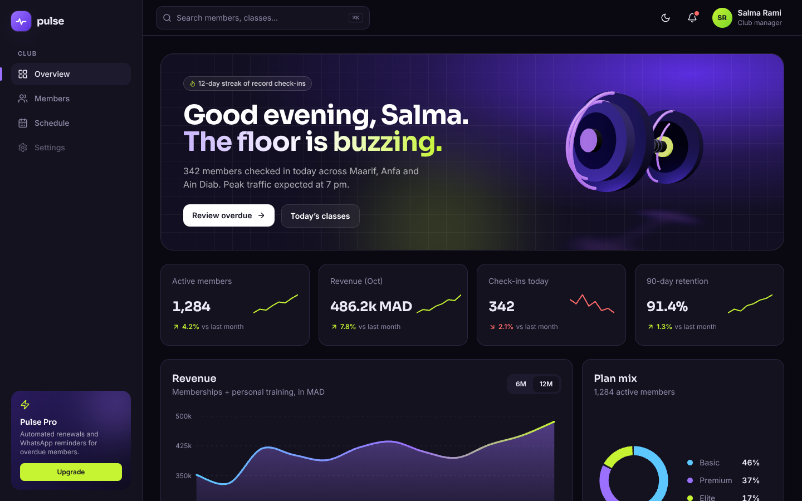
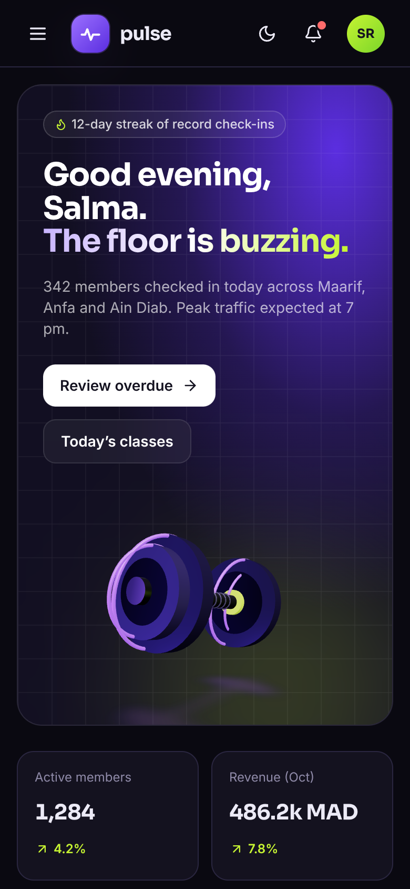

# Pulse — Gym Admin Dashboard

> A dark, motion-rich admin dashboard for a multi-branch fitness club in Casablanca, with a real-time 3D dumbbell in the hero.



<p align="center"></p>

## Features

- **3D hero**: a dumbbell built entirely from Three.js primitives (cylinders, tori, rings) with React Three Fiber. It floats, follows the pointer, tilts with scroll and is lit by a procedural `Lightformer` studio, so no HDR or model files are downloaded. Lazy-loaded with `React.lazy` + `Suspense`, DPR capped at 2, with a glow fallback when WebGL is missing.
- **Animated KPI cards**: count-up numbers (framer-motion `animate`), self-drawing sparklines and a hover glow.
- **Hand-built SVG area chart**: Catmull-Rom smoothed curve that draws itself, gradient fill, a spring-following crosshair and tooltip, and a 6M / 12M toggle with a shared-layout pill.
- **Plan-mix donut and peak-hour bars** that animate in on scroll.
- **Members table**: search by name, ID or branch, status filter with animated counts, plan filter and sortable columns. Rows re-order with layout animations; on mobile the table becomes a card list. An animated empty state appears when nothing matches.
- **Slide-over member panel**: spring-driven drawer with staggered content, 8-week attendance chart and contextual actions (Esc or backdrop to close).
- **Weekly schedule** with an animated day underline (`layoutId`), staggered class cards and capacity bars that warn when a class is nearly full.
- **Route transitions** between Overview, Members and Schedule (fade, lift and blur with `AnimatePresence`), a sidebar active indicator that glides between links, and a mobile drawer.
- **Light / dark theme** toggle built on CSS variables, saved in `localStorage`.
- Fully responsive down to 375px and honours `prefers-reduced-motion`.

## Tech stack


## Getting started

```bash
npm install
npm run dev      # http://localhost:5173
npm run build    # production build in dist/
npm run preview  # serve the production build
```

`vercel.json` rewrites every path to `index.html` so client-side routes like `/members` work on refresh.

## Project structure

```
src/
├── components/
│   ├── Layout.jsx        # sidebar, drawer, topbar, route transitions
│   ├── Sidebar.jsx       # nav with gliding active indicator
│   ├── Topbar.jsx        # search, theme toggle, notifications
│   ├── KpiCard.jsx       # count-up + sparkline
│   ├── CountUp.jsx
│   ├── AreaChart.jsx     # hand-drawn SVG chart with tooltip
│   ├── PlanDonut.jsx
│   ├── PeakBars.jsx
│   ├── MemberPanel.jsx   # slide-over detail panel
│   └── ui.jsx            # avatar, badges, formatters
├── pages/
│   ├── Overview.jsx      # 3D hero, KPIs, charts
│   ├── Members.jsx       # search / filter / sort table
│   └── Schedule.jsx      # weekly classes
├── three/
│   ├── Dumbbell.jsx      # procedural 3D dumbbell scene
│   └── webgl.js
├── data/                 # mock members, stats and class schedule
├── hooks/useTheme.js
├── App.jsx
└── main.jsx              # Router + MotionConfig reducedMotion="user"
```

## Design notes

**Palette** — a near-black violet canvas (`#0A0911`) with layered surfaces (`#14121F`, `#1D1A2E`), an electric purple accent (`#9B70FF` in dark, `#7C4DF0` in light) and a high-energy lime (`#C6F432`) reserved for positive signals and the single most important number on a chart. Coral (`#FF6B6B`) and sky (`#5CC8FF`) mark overdue and paused states. All colours are CSS variables, so the light theme is a token swap, not a second stylesheet.

**Typography** — [Sora](https://fonts.google.com/specimen/Sora) for headings and numbers (geometric, athletic, very legible at large sizes) paired with [Inter](https://fonts.google.com/specimen/Inter) for dense UI text. Numbers use tabular figures so count-ups do not jitter.

**Motion** — dashboards are used every day, so motion is quick and purposeful:
- Springs with high stiffness (`420–500`) for indicators and pills so they feel snappy, never floaty.
- Data visualisations *draw* themselves once, then stay still; hover interactions use springs so the crosshair tracks smoothly.
- Route changes use a 350 ms fade/lift/blur so the frame stays stable while content swaps.
- The 3D dumbbell is the one expressive moment, kept inside the hero and damped with `THREE.MathUtils.damp`.
- `<MotionConfig reducedMotion="user">` and `useReducedMotion` (count-ups render final values instantly) respect accessibility settings.

## Author

**Zakaria Dabella** — UI/UX designer & web developer based in Casablanca, Morocco.

- Portfolio: [zakaria-dabella-portfolio.vercel.app](https://zakaria-dabella-portfolio.vercel.app/)
- GitHub: [@zakaria10-dabella](https://github.com/zakaria10-dabella)

## License

[MIT](LICENSE) © 2026 Zakaria Dabella
